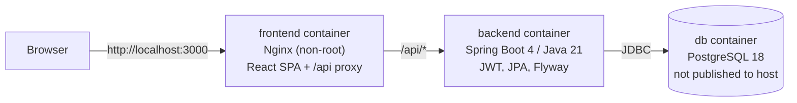

# eBank: banking simulation platform

A full-stack banking **simulation** built with Spring Boot and React. Agents onboard clients and open accounts; clients see their accounts and balances. It is being developed in phases into a small multi-tenant SaaS demo with a correct transfer engine.

> **Simulation only.** eBank is an educational and portfolio project. It moves no real money, connects to no payment network, is not a bank and makes no regulatory claims. Use synthetic data only.

## Status

| Area | State |
|---|---|
| Authentication (JWT), roles `AGENT` / `CLIENT` | Working, tested |
| Client onboarding by an agent (one-time password) | Working, tested |
| Account opening (server-generated RIB, currency, initial deposit) | Working, tested |
| Client account overview | Working, tested |
| Tenant isolation (organization scoping) | Foundation in place and tested; a single "Demo Bank" organization is seeded |
| **Transfers and transaction history** | **Not implemented yet** (next phase); the transfer screen says so |
| Multi-tenant administration, plans and quotas | Planned |
| Cloud deployment | Not deployed |

The full plan, with acceptance criteria, is in [docs/ROADMAP.md](docs/ROADMAP.md). The initial audit is in [docs/PROJECT_AUDIT.md](docs/PROJECT_AUDIT.md), and design decisions are in [docs/DECISIONS.md](docs/DECISIONS.md).

## Architecture



- **Backend:** a modular monolith with controllers, services, repositories, entities and DTOs.
  - Errors are RFC 7807 problem details with stable codes.
  - Every tenant-owned query is scoped to the caller's organization, which is loaded from the database and never taken from the request.
- **Database:** the schema is defined by Flyway migrations; Hibernate only validates it.
  - Money is `NUMERIC(19,2)`.
  - Constraints enforce non-negative balances and same-organization ownership.
- **Frontend:** React 19 + React Router, built with Vite. The API is called same-origin (`/api`).

## Tech stack

| Layer | Technology |
|---|---|
| Backend | Java 21, Spring Boot 4.1, Spring Security 7, Spring Data JPA (Hibernate 7), Bean Validation, jjwt 0.13 |
| Database | PostgreSQL 18, Flyway |
| Frontend | React 19, React Router 7, Axios, Vite 8 |
| Tests | JUnit 5, Spring MockMvc, Testcontainers (PostgreSQL), Vitest, Testing Library |
| Delivery | Docker (multi-stage, non-root images), Docker Compose, GitHub Actions, Dependabot |

## Run with Docker (recommended)

Prerequisites: Docker with Compose v2.

```bash
cp .env.example .env        # Windows: copy .env.example .env
# Fill in POSTGRES_PASSWORD, APP_JWT_SECRET (openssl rand -hex 32) and DEMO_AGENT_PASSWORD (12+ chars)
docker compose up --build -d --wait
```

Open http://localhost:3000 and sign in as the demo agent, `agent@demo.ebank.test`, with the `DEMO_AGENT_PASSWORD` from your `.env`. As the agent:
1. Onboard a client. The response shows the client's **one-time password**, once.
2. Open an account for that client.
3. Log out and sign in as the client to see the account.

Stop with `docker compose down`. Add `-v` to also delete the database volume.

## Run locally without Docker

Prerequisites: JDK 21, Node 24, a PostgreSQL database.

```bash
# Backend: configure your database once
cp ebank-backend/src/main/resources/application-local.yml.example \
   ebank-backend/src/main/resources/application-local.yml     # git-ignored; edit URL/user/password/secrets
cd ebank-backend
./mvnw spring-boot:run -Dspring-boot.run.profiles=local,demo    # http://localhost:8080

# Frontend (second terminal): Vite proxies /api to localhost:8080
cd ebank-frontend
npm ci
npm run dev                                                     # http://localhost:3000
```

## Tests

```bash
cd ebank-backend && ./mvnw verify            # unit + integration tests; needs Docker for Testcontainers
cd ebank-frontend && npm run lint && npm test && npm run build
```

CI runs the same commands on every push and pull request (`.github/workflows/ci.yml`).

## Configuration

| Variable | Used by | Purpose |
|---|---|---|
| `POSTGRES_DB`, `POSTGRES_USER`, `POSTGRES_PASSWORD` | db, backend | Database name and credentials |
| `APP_JWT_SECRET` | backend | HMAC key; **at least 32 bytes**, the app refuses to start otherwise |
| `APP_JWT_EXPIRATION` | backend | Token lifetime, e.g. `60m` |
| `SPRING_PROFILES_ACTIVE` | backend | `demo` seeds the demo agent |
| `DEMO_AGENT_USERNAME`, `DEMO_AGENT_PASSWORD` | backend | Demo agent credentials (no built-in default password) |
| `FRONTEND_PORT` | frontend | Host port, default 3000 |

Secrets live only in `.env` / `application-local.yml`, both git-ignored. `VITE_*` variables are embedded in the public JavaScript bundle and must never hold secrets.

## API overview

| Method & path | Role | Description |
|---|---|---|
| `POST /api/auth/login` | public | `{username, password}` → `{accessToken, tokenType, expiresIn, user}` |
| `GET /api/auth/me` | any | Current user (id, username, roles, organization) |
| `POST /api/admin/clients` | AGENT | Onboard a client → client, username, one-time password |
| `POST /api/admin/accounts` | AGENT | `{clientId, currency?, initialDeposit?}` → account with generated RIB |
| `GET /api/admin/clients/{id}/accounts` | AGENT | Accounts of a client of the agent's organization |
| `GET /api/client/accounts` | CLIENT | The caller's own accounts |
| `GET /actuator/health` | public | Liveness/readiness |

Errors use the `application/problem+json` format, for example `{"status":409,"code":"EMAIL_TAKEN","detail":"..."}`.

## Known limitations

- Transfers, transaction history, pagination and client search are not implemented yet.
- The JWT is stored in `localStorage`; moving it to an HttpOnly cookie with CSRF protection is planned (ADR-008). There is no rate limiting on login yet.
- Clients are not yet forced to change their one-time password.
- Single seeded organization; organization management comes later.

## License

No license has been chosen yet; all rights reserved by the author.
