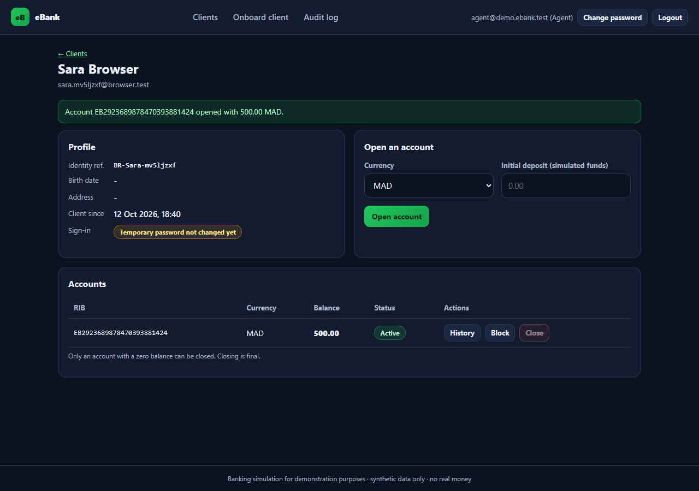
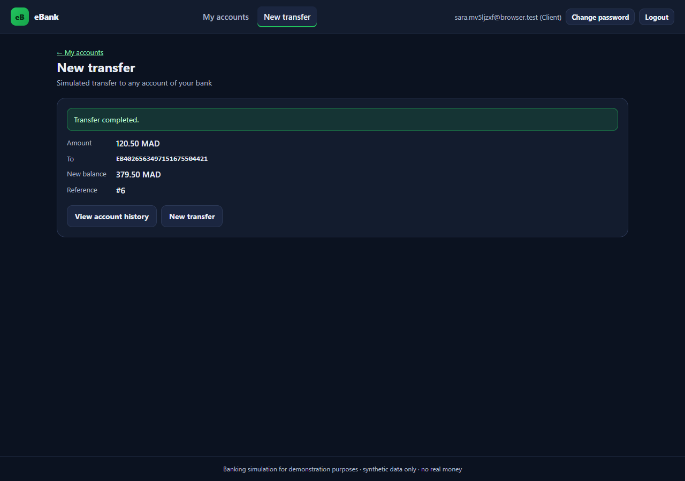
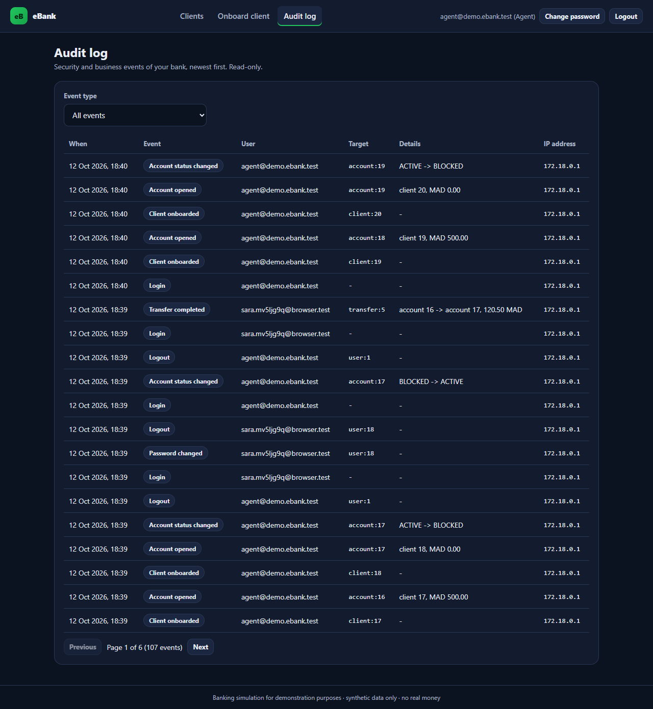
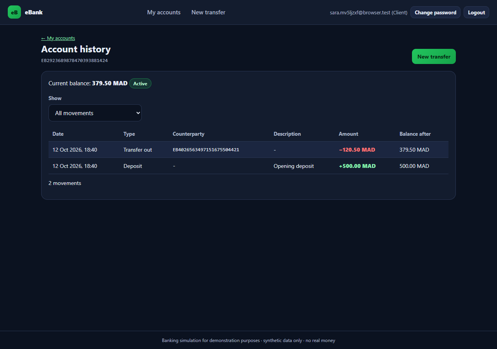
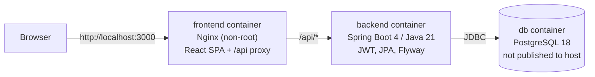
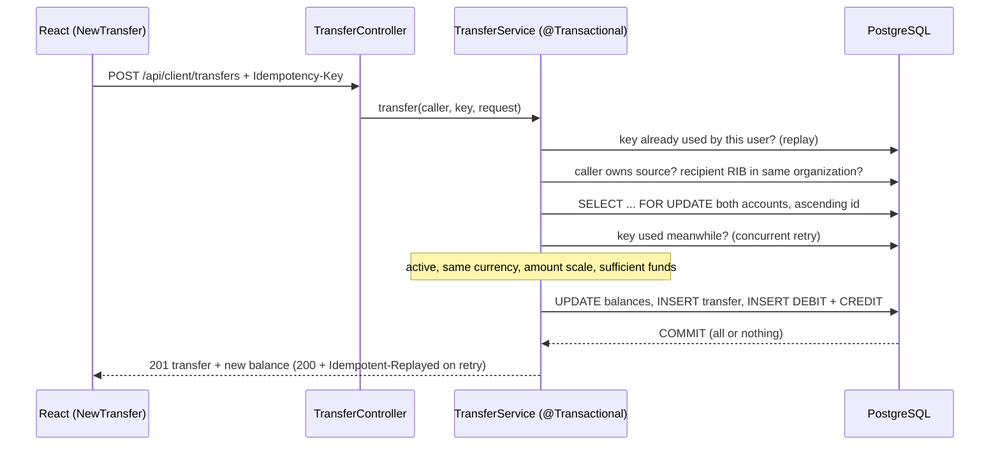

# eBank: banking simulation platform

A full-stack banking **simulation** built with Spring Boot and React. Agents onboard clients and open accounts; clients transfer money between accounts and browse their history. The transfer engine is atomic, safe under concurrency and idempotent, and backed by an append-only ledger. The project is being developed in phases into a small multi-tenant SaaS demo.

> **Simulation only.** eBank is an educational and portfolio project. It moves no real money, connects to no payment network, is not a bank and makes no regulatory claims. Use synthetic data only.

## Status

| Area | State |
|---|---|
| Authentication (JWT), roles `AGENT` / `CLIENT` | Working, tested |
| Client onboarding by an agent (one-time password) | Working, tested |
| Account opening (server-generated RIB, currency, initial deposit) | Working, tested |
| Client account overview | Working, tested |
| Tenant isolation (organization scoping) | Foundation in place and tested; a single "Demo Bank" organization is seeded |
| Transfers to any account of the same bank (by RIB), with review/confirm step | Working, tested (incl. concurrency on real PostgreSQL) |
| Append-only ledger, paginated and filterable account history | Working, tested |
| Multi-tenant administration, plans and quotas | Planned |
| Security hardening: HttpOnly cookie sessions + CSRF, revocation, forced first-login password change, login throttling, CSP, audit trail, least-privilege DB role | Working, tested (incl. a real-browser run) |
| Agent workspace: client search, client detail, account block / unblock / close, account history, audit log | Working, tested (unit, integration, real browser) |
| Accessible, responsive UI (axe-core: 0 violations on 8 pages; usable at 375 px) | Verified in headless Chrome |
| Cloud deployment | Not deployed |

The full plan, with acceptance criteria, is in [docs/ROADMAP.md](docs/ROADMAP.md). The initial audit is in [docs/PROJECT_AUDIT.md](docs/PROJECT_AUDIT.md), and design decisions are in [docs/DECISIONS.md](docs/DECISIONS.md).

## Screenshots

Taken in headless Chrome against the Docker stack (synthetic data).

| Agent: client detail | Client: transfer completed |
|---|---|
|  |  |
| **Agent: audit log** | **Client: account history** |
|  |  |

More in [docs/screenshots](docs/screenshots), including the 375 px mobile layout.

## Architecture



- **Backend:** a modular monolith with controllers, services, repositories, entities and DTOs.
  - Errors are RFC 7807 problem details with stable codes.
  - Every tenant-owned query is scoped to the caller's organization, which is loaded from the database and never taken from the request.
- **Database:** the schema is defined by Flyway migrations; Hibernate only validates it.
  - Money is `NUMERIC(19,2)`.
  - Constraints enforce non-negative balances and same-organization ownership.
  - Triggers make transfers and ledger entries append-only.
- **Frontend:** React 19 + React Router, built with Vite. The API is called same-origin (`/api`).
- **Security:**
  - The session is an `HttpOnly`, `SameSite=Strict` cookie, with CSRF double-submit protection.
  - Logout and password change revoke every session.
  - Clients must replace their one-time password before banking.
  - Logins are throttled.
  - Nginx sends a strict Content-Security-Policy.
  - Security and business events go to an append-only audit trail.
  - The application connects with a database role that cannot change the schema or rewrite the ledger and audit history.

### How a transfer is processed



Design decisions and trade-offs: [ADR-010 (ledger)](docs/DECISIONS.md#adr-010--ledger-as-source-of-truth-stored-balance-as-a-transactional-cache), [ADR-011 (locking)](docs/DECISIONS.md#adr-011--concurrency-pessimistic-row-locks-in-a-global-order), [ADR-012 (idempotency)](docs/DECISIONS.md#adr-012--idempotency-key-for-transfer-creation).

## Tech stack

| Layer | Technology |
|---|---|
| Backend | Java 21, Spring Boot 4.1, Spring Security 7, Spring Data JPA (Hibernate 7), Bean Validation, jjwt 0.13 |
| Database | PostgreSQL 18, Flyway |
| Frontend | React 19, React Router 7, Axios, Vite 8 |
| Tests | JUnit 5, Spring MockMvc, Testcontainers (PostgreSQL), Vitest, Testing Library |
| Delivery | Docker (multi-stage, non-root images), Docker Compose, GitHub Actions, Dependabot |

## Run with Docker (recommended)

Prerequisites: Docker with Compose v2.

```bash
cp .env.example .env        # Windows: copy .env.example .env
# Fill in POSTGRES_PASSWORD, APP_JWT_SECRET (openssl rand -hex 32) and DEMO_AGENT_PASSWORD (12+ chars)
docker compose up --build -d --wait
```

> **Upgrading from an earlier checkout?** Since Phase 3 the database volume must be created with the restricted application role: run `docker compose down -v` once. This deletes the demo data.

Open http://localhost:3000 and sign in as the demo agent, `agent@demo.ebank.test`, with the `DEMO_AGENT_PASSWORD` from your `.env`. As the agent:
1. Onboard a client. The response shows the client's **one-time password**, once.
2. Open an account for that client.
3. Open a second account (same currency) for another client.
4. Log out and sign in as the first client with the one-time password. You are asked to choose your own password.
5. Make a transfer to the second account's RIB, then open the account history.

Stop with `docker compose down`. Add `-v` to also delete the database volume.

## Run locally without Docker

Prerequisites: JDK 21, Node 24, a PostgreSQL database.

```bash
# Backend: configure your database once
cp ebank-backend/src/main/resources/application-local.yml.example \
   ebank-backend/src/main/resources/application-local.yml     # git-ignored; edit URL/user/password/secrets
cd ebank-backend
./mvnw spring-boot:run -Dspring-boot.run.profiles=local,demo    # http://localhost:8080

# Frontend (second terminal): Vite proxies /api to localhost:8080
cd ebank-frontend
npm ci
npm run dev                                                     # http://localhost:3000
```

## Tests

```bash
cd ebank-backend && ./mvnw verify            # unit + integration tests; needs Docker for Testcontainers
cd ebank-frontend && npm run lint && npm test && npm run build
```

CI runs the same commands on every push and pull request (`.github/workflows/ci.yml`).

## Configuration

| Variable | Used by | Purpose |
|---|---|---|
| `POSTGRES_DB`, `POSTGRES_USER`, `POSTGRES_PASSWORD` | db, backend | Database name and schema-owner credentials (used by Flyway only) |
| `APP_DB_USER`, `APP_DB_PASSWORD` | db, backend | Restricted role the application connects with |
| `APP_COOKIE_SECURE` | backend | `true` by default (browsers accept Secure cookies on http://localhost) |
| `APP_JWT_SECRET` | backend | HMAC key; **at least 32 bytes**, the app refuses to start otherwise |
| `APP_JWT_EXPIRATION` | backend | Token lifetime, e.g. `60m` |
| `SPRING_PROFILES_ACTIVE` | backend | `demo` seeds the demo agent |
| `DEMO_AGENT_USERNAME`, `DEMO_AGENT_PASSWORD` | backend | Demo agent credentials (no built-in default password) |
| `FRONTEND_PORT` | frontend | Host port, default 3000 |

Secrets live only in `.env` / `application-local.yml`, both git-ignored. `VITE_*` variables are embedded in the public JavaScript bundle and must never hold secrets.

## API overview

| Method & path | Role | Description |
|---|---|---|
| `GET /api/auth/csrf` | public | Sets the `XSRF-TOKEN` cookie (call once before any POST) |
| `POST /api/auth/login` | public | `{username, password}` → `{expiresIn, user}`; sets the `EBANK_SESSION` HttpOnly cookie. 429 when throttled |
| `GET /api/auth/me` | any | Current user (id, username, roles, organization, `passwordChangeRequired`) |
| `POST /api/auth/password` | any | `{currentPassword, newPassword}`; revokes other sessions, sets a new cookie |
| `POST /api/auth/logout` | any | Revokes all the user's sessions and clears the cookie |
| `GET /api/admin/audit-events` | AGENT | Audit trail of the agent's organization (`page`, `size`, `type`) |
| `POST /api/admin/clients` | AGENT | Onboard a client → client, username, one-time password |
| `POST /api/admin/accounts` | AGENT | `{clientId, currency?, initialDeposit?}` → account with generated RIB |
| `GET /api/admin/clients?q=&page=&size=` | AGENT | Search the organization's clients (name, email, identity reference), with account counts |
| `GET /api/admin/clients/{id}` | AGENT | Client profile, onboarding state and accounts |
| `GET /api/admin/clients/{id}/accounts` | AGENT | Accounts of a client of the agent's organization |
| `GET /api/admin/accounts/{id}` | AGENT | One account of the organization |
| `PATCH /api/admin/accounts/{id}/status` | AGENT | `{status: ACTIVE\|BLOCKED\|CLOSED}`; closing needs a zero balance and is final |
| `GET /api/client/accounts` | CLIENT | The caller's own accounts |
| `POST /api/client/transfers` | CLIENT | Header `Idempotency-Key`; `{sourceAccountId, destinationRib, amount, description?}` → transfer + new balance |
| `GET /api/client/accounts/{id}/entries` | CLIENT | Own account history: `page`, `size` (≤100), `type` (DEPOSIT/DEBIT/CREDIT), `from`/`to` (dates, UTC) |
| `GET /api/admin/accounts/{id}/entries` | AGENT | History of any account of the agent's organization |
| `GET /actuator/health` | public | Liveness/readiness |

Errors use the `application/problem+json` format, for example `{"status":409,"code":"EMAIL_TAKEN","detail":"..."}`.

Browsers authenticate with the session cookie, and every POST needs the `X-XSRF-TOKEN` header. Scripts and API clients can instead send `Authorization: Bearer <token>` (the token is the cookie's value), which needs no CSRF token.

## Known limitations

- No transfer reversals, scheduled transfers or FX; transfers are same-currency only.
- Login throttling is in memory (per instance, reset on restart). There is no refresh token: users sign in again when the session expires (60 minutes by default).
- Locally there is no HTTPS (and therefore no HSTS); that belongs to the deployment's TLS entry point.
- Single seeded organization; organization management comes later.

## License

No license has been chosen yet; all rights reserved by the author.
