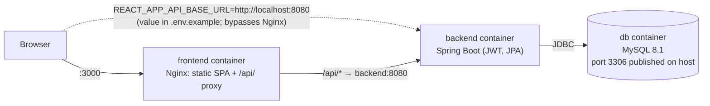
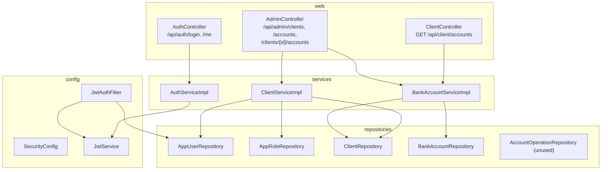
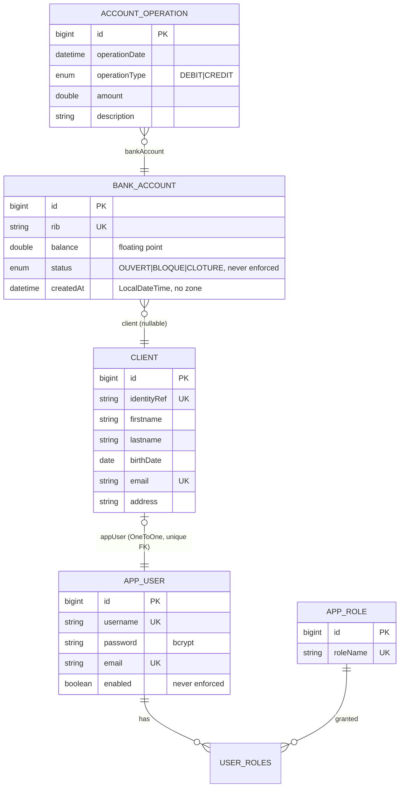
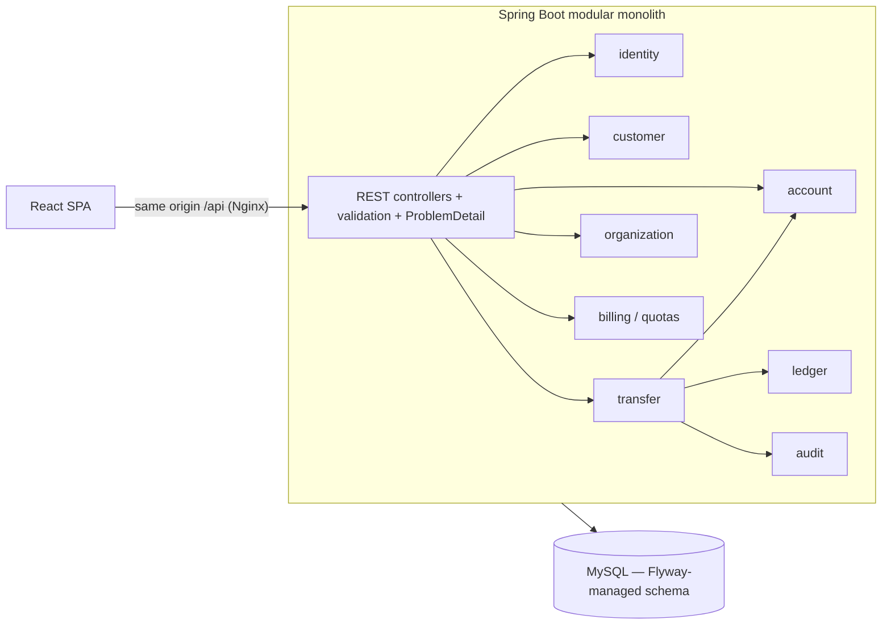

# eBank — Phase 0 Project Audit

| | |
|---|---|
| Audit date | 2026-10-12 |
| Commit audited | `27b9aed` (branch `main`; only untracked change is this `docs/` folder) |
| Scope | Entire repository: backend, frontend, Docker/Nginx, configuration, documentation |
| Application code changed | **None.** All build/run experiments were done on throwaway copies (`git archive HEAD`) outside the repository. All Docker containers, networks and volumes created for the audit were removed afterwards. |
| Revision | **Rev 2 (re-verification).** Every code-level finding was re-read against the source. The build, test and runtime checks were re-run, this time with Docker available: real images, real Tomcat, **real MySQL 8.1** (§8.4). Corrections to Rev 1 are marked **(corrected in Rev 2)**. |

**Evidence legend** used throughout:

- **[RUN]** — verified by executing something (command output quoted in §8).
- **[PROBE]** — verified at runtime with a throwaway MockMvc test against the real Spring context (H2 in-memory DB, scratch copy only; see §8.3). Proves HTTP/security/serialization behaviour, **not** MySQL-specific behaviour. *(Rev 1 evidence; most items re-confirmed by [MYSQL].)*
- **[MYSQL]** — verified by running the packaged jar (JDK 17) in Docker against MySQL 8.1 and calling it over HTTP with `curl`, plus the real frontend Nginx image (§8.4). This is the closest available evidence to how `docker compose` would behave.
- **[CODE]** — established by reading the code and tracing the execution path; not executed.

---

## 1. Executive summary

eBank is a small (≈40 backend files, ≈15 frontend files, 13 commits) Spring Boot + React application. The layering is clean and conventional, so it's a reasonable base. As committed, though, it **does not build, cannot start in Docker, has no working tests, and its central banking feature (transfers) does not exist on the backend.**

Headline facts:

1. **The backend does not compile as committed** [RUN]. `pom.xml` declares `mysql:mysql-connector-j`, which Spring Boot 3.2.5 does not manage, so Maven rejects the POM.
2. **`docker compose up` cannot succeed** [RUN + CODE]. The backend Dockerfile runs `./mvnw`, but `mvnw` has never been committed (checked against Git history). Even with that fixed, three more problems stop the stack: the POM error above, the `.env.example` JWT placeholder that the JWT library rejects at startup [PROBE], and no schema creation (`ddl-auto` is not set in the container).
3. **Every account listing leaks the account owner's bcrypt password hash and role list** [PROBE]. Controllers return JPA entities directly, and `BankAccount → Client → AppUser` serializes `password`.
4. **Once any account has an operation, account listings break with infinite JSON recursion** [PROBE] (`BankAccount.operations ↔ AccountOperation.bankAccount`). A transfer engine built on the current entities would immediately break the client dashboard.
5. **No transfer engine, no transaction history, no pagination** [PROBE: `POST /api/client/transfers` → 404 under MockMvc; **403** in a real container, see item 10]. The frontend transfer form posts to an endpoint that doesn't exist.
6. **Money is stored as `double`** [CODE, PROBE: `0.1 + 0.2 = 0.30000000000000004`]. There is no currency field, no `@Transactional` anywhere, and no locking or versioning.
7. **Every onboarded client gets the same hard-coded password `client123`**, and `admin/admin123` is seeded in every environment [PROBE]. Disabled users can still log in, and their existing tokens keep working [PROBE].
8. **Zero meaningful tests.** The backend has one `contextLoads` test that fails without a database [RUN], and the frontend has no tests (`npm test` exits 1, "No tests found") [RUN].
9. The README overstates the project: a "build passing" badge, "microservice architecture", `./mvnw` instructions, and a `/api/auth/me` that "retrieves the current user profile" (it's public and returns a fixed string [PROBE]).
10. **In a real servlet container, every error is reported as `403` with an empty body** [MYSQL]. Bad credentials, unknown endpoints, validation crashes (NPE), unknown client, duplicate RIB and DB constraint violations all look identical. Spring forwards unhandled errors to `/error`, and that dispatch falls under `anyRequest().authenticated()` without the JWT filter running (*new in Rev 2*). The frontend cannot tell a business error from an authorization failure.
11. **The SPA cannot log in through Nginx with the compose default** [MYSQL]. The bundle is built with `baseURL:"/api"` and calls `"/api/auth/login"`, so the browser requests `/api/api/auth/login`, which returns 403. The only working setup is the `.env.example` value `http://localhost:8080`, which bypasses Nginx entirely (*new in Rev 2*).

None of this is unusual for a student project, and the structure makes every item fixable incrementally. The order matters, though. **The foundations (build, tests, DTO boundary, money type, schema migrations) have to come before the transfer engine**, so §13 adds a short foundation phase before the transfer phase.

---

## 2. Verified technology stack

| Layer | Documented | Actually in repo | Notes |
|---|---|---|---|
| Language (backend) | Java 17 | `java.version=17` (pom); Dockerfile uses Temurin 17 | Local machine has JDK 23 only. With JDK 23, Lombok is not run because the POM doesn't declare it in `annotationProcessorPaths` [RUN]. **On JDK 17 (`maven:3.9-eclipse-temurin-17` container), the code compiles once only the driver groupId is fixed** [RUN, Rev 2]. |
| Framework | Spring Boot 3.2.5 | Spring Boot 3.2.5 parent | The 3.2.x line is past its open-source support window. An upgrade is needed (verify the current supported line at implementation time). |
| Security | Spring Security, JWT | Spring Security 6 (Boot-managed), **jjwt 0.11.5** (deprecated builder/parser API) | |
| Persistence | Spring Data JPA / Hibernate | Yes; `ddl-auto=update` in the example config, **no migration tool** | |
| DB driver | — | `mysql:mysql-connector-j` **(wrong groupId → build failure)** | Correct coordinate: `com.mysql:mysql-connector-j`. |
| Database | MySQL 8.1 | `mysql:8.1` image | 8.1 was a short-lived "innovation" release. An LTS line (8.0/8.4) is preferable. |
| Build tool | Maven + `./mvnw` | `.mvn/wrapper/maven-wrapper.properties` only; **`mvnw` / `mvnw.cmd` missing** | |
| Frontend | React 19.2.1, Router 7.10.1, Axios 1.13.2 | Same, **JavaScript (JSX)**, bootstrapped with **Create React App (`react-scripts` 5.0.1)** | CRA is deprecated upstream. |
| Frontend tests | "npm test" | Testing Library is installed; **0 test files** | |
| Infra | Docker Compose + Nginx | `docker-compose.yml` (db, backend, frontend); Nginx inside the frontend image serves the SPA and proxies `/api/` | |
| CI | "build passing" badge | **No CI configuration** (no `.github/workflows`) | The badge is a static shields.io image. |
| API docs | README section | No OpenAPI/springdoc | |
| Observability | — | No actuator, no logging statements, no health checks | |

---

## 3. Current architecture

### 3.1 Runtime view (as designed in `docker-compose.yml`)



The Nginx proxy is effectively bypassed. `.env.example` sets `REACT_APP_API_BASE_URL=http://localhost:8080`, so the browser calls the backend directly, cross-origin. Leaving it unset doesn't help: the compose default `/api` combined with request paths that already start with `/api/...` produces `/api/api/...` URLs [CODE].

### 3.2 Backend structure (package-by-layer)



### 3.3 Domain model (actual entities)



There is no organization or tenant concept, no currency, no transfer entity, and no version or lock column. The balance is **stored** (`BankAccount.balance`), and nothing ever writes `AccountOperation`.

The actual MySQL DDL generated by Hibernate [MYSQL] has these properties:
- `balance double NOT NULL` and `amount double NOT NULL`.
- `status enum(...) DEFAULT NULL`, `operation_type DEFAULT NULL`, and nullable `client_id` / `bank_account_id` FKs.
- `client.app_user_id` **has** a unique key.
- Constraint names are Hibernate-generated (`UK_me3g8…`, `FKjuqw…`).
- There are no indexes beyond PK, UK and FK.

---

## 4. Feature inventory

| Feature | Status | Evidence |
|---|---|---|
| Backend build | **Broken** | `mvn compile` fails on POM [RUN] |
| Docker Compose one-command start | **Broken** | `mvnw` missing; plus see S-5, B-3 [RUN/CODE] |
| Login (JWT issue) | Implemented & verified* | 200 + token for seeded admin [PROBE] |
| Login failure handling | Partially implemented | Bad credentials → **403 with empty body** (expected 401) [PROBE, MYSQL] |
| Login through the Docker/Nginx path | **Broken** | SPA calls `/api/api/auth/login` → 403 [MYSQL] (see §1 item 11) |
| `GET /api/auth/me` | **Broken** (misleading) | Public; returns `"You are authenticated"` to anyone [PROBE] |
| Role-based route protection (server) | Implemented & verified* | CLIENT→admin API 403; AGENT→client API 403; no token 403 [PROBE] |
| Client onboarding by agent | Implemented, **defective** | Works for the happy path. Defects: username collision, null email, invalid email (D-5) [PROBE, MYSQL]; **orphan login-capable user on partial failure** (D-3) [MYSQL] |
| Bank-account creation by agent | Implemented, **defective** | Accepts negative balance, unhandled errors on duplicate RIB / unknown client [PROBE] |
| Client "my accounts" | Implemented, **leaks secrets** | Returns entity graph incl. password hash [PROBE] |
| Agent "accounts of client X" | Backend only | Endpoint exists [PROBE]; **no UI uses it** [CODE] |
| Client list / search for agents | Not implemented | No endpoint, no UI; agent must already know a numeric `clientId` |
| Client dashboard (balances) | Implemented & verified (backend data) | Balances/total come from `GET /api/client/accounts` [CODE]; nothing fabricated |
| Transfer UI | Implemented (UI only) | Form posts to `/api/client/transfers` |
| Transfer engine | **Not implemented** | No handler: 404 under MockMvc [PROBE], 403 in a real container [MYSQL] |
| Transaction history | **Not implemented** | `getAccountDashboard` calls a non-existent endpoint (404 [PROBE] / 403 [MYSQL]); `OperationsTable` unused |
| Pagination & filters | **Not implemented** | |
| Profile management | **Not implemented** | No endpoint or page |
| Password change / first-login reset | **Not implemented** | All clients keep `client123` |
| Logout | Partially / **broken on client page** | Navbar logout works [CODE]; Client dashboard logout removes key `token` instead of `accessToken`, so the token survives [CODE] |
| Session restore on page refresh | **Broken** | See F-1 [CODE] |
| Token-expiry handling in UI | Not implemented | No response interceptor; expired token leaves UI "logged in" with errors [CODE] |
| Account status enforcement (blocked/closed) | Not implemented | Enum exists, never checked [CODE] |
| Admin analytics | Not implemented | (README roadmap) |
| Multi-tenancy / organizations | Not implemented | |
| Backend tests | **Broken** | 1 test, fails (no datasource) [RUN] |
| Frontend tests | Not implemented | 0 tests, `npm test` exits 1 [RUN] |
| Frontend production build | Implemented & verified | `CI=true npm run build` succeeds [RUN] |
| CI pipeline | Not implemented | |
| OpenAPI docs | Not implemented | |
| Health checks / actuator | Not implemented | |
| Cloud deployment | Not implemented | |

\* "Verified" here means verified over HTTP against MySQL 8.1 in Docker [MYSQL]. It does **not** mean verified in a browser.

---

## 5. Key user journeys (actual execution paths)

### 5.1 Login

```mermaid
sequenceDiagram
  participant UI as LoginPage.jsx
  participant AX as axiosClient
  participant SEC as Security filter chain
  participant AC as AuthController
  participant AS as AuthServiceImpl
  participant AM as AuthenticationManager (DaoAuthenticationProvider, BCrypt)
  participant DB as MySQL
  UI->>AX: POST /api/auth/login {username,password}
  AX->>SEC: (permitAll)
  SEC->>AC: login()
  AC->>AS: login()
  AS->>AM: authenticate()
  AM->>DB: SELECT app_user by username (+roles EAGER)
  Note over AM: enabled flag NOT mapped → disabled users pass
  AS->>DB: SELECT app_user again
  AS-->>UI: {accessToken, username, role=first role, expiresIn=3600 (hard-coded)}
  UI->>UI: localStorage.setItem(accessToken, username, role)
  Note over UI: on failure server returns 403 empty body; UI shows generic error
```

### 5.2 Authenticated request

`axiosClient` request interceptor adds `Authorization: Bearer <token>` from `localStorage`. On the backend, `JwtAuthFilter` validates the signature and expiry, **loads the user from the DB on every request** and builds authorities from DB roles. That makes role changes take effect immediately, which is good, but the filter ignores `enabled`. An invalid token is silently ignored, so the request continues unauthenticated and is rejected with 403, not 401 [PROBE].

### 5.3 Client views accounts

`ClientDashboard` → `GET /api/client/accounts` → `hasRole('CLIENT')` → `BankAccountServiceImpl.getMyAccounts(auth)` → `findByClient_AppUser_Username(auth.getName())` → **returns `List<BankAccount>` entities** → Jackson walks `client → appUser (password, roles)` and `operations` (lazy, loaded by Open-Session-in-View, one query per account = N+1).

Object-level authorization here is **correct**: the account list is scoped by the authenticated username, and there is no client-supplied ID to tamper with.

### 5.4 Agent onboards a client

`AdminDashboard` → `POST /api/admin/clients` → `@PreAuthorize('AGENT_GUICHET')` → `ClientServiceImpl.addClient`:
1. Uniqueness pre-checks (racy; no transaction).
2. `username = email.split("@")[0]`, `password = "client123"`.
3. `save(AppUser)`, then `save(Client)` — **two separate transactions**. A failure in step 3b leaves an orphan `AppUser` with role CLIENT who can log in but has no client record. **Confirmed [MYSQL]:** `POST /api/admin/clients {"email":"bob@b.test"}` (no `identityRef`) returned 403. The `app_user` row `bob` was still committed, and `bob`/`client123` then received a valid JWT.

The response message reveals the login name. The UI only displays `message`, so the agent never sees the new client's numeric id, which the "create account" form then requires.

### 5.5 Client transfer

`NewTransfer` → `POST /api/client/transfers {fromRib,toRib,amount,motif}` → **no handler** (404 under MockMvc [PROBE]; surfaces as 403 in a real container [MYSQL]) → UI shows "Transfer failed." No balance changes. The journey **does not exist end-to-end**.

---

## 6. Security findings

Severity reflects impact if the app were deployed publicly, weighted by likelihood. Today it runs only locally.

| ID | Severity | Finding | Evidence |
|---|---|---|---|
| S-1 | **Critical** | **Password hashes and roles leaked in API responses.** `GET /api/client/accounts` and `GET /api/admin/clients/{id}/accounts` serialize `BankAccount → Client → AppUser` including `password` (bcrypt) and `roles`. Cause: entities returned directly from controllers. | [PROBE] response contains `"password"` and `$2a$` |
| S-2 | **Critical** (if deployed) | **Shared, hard-coded default password `client123` for every client**, never forced to change, and no change-password feature. Usernames are predictable (email local-part). Anyone who knows a client's email can log in as them. | [PROBE] `ClientServiceImpl.java:35` |
| S-3 | **Critical** (if deployed) | **Seeded `admin/admin123` agent in every environment** (`EbankApplication.java:35-43`), not conditional on a profile and not configurable. | [PROBE] login 200 |
| S-4 | High | **`enabled` flag not enforced.** Disabled users can log in, and their existing tokens keep working. There is no way to revoke access. | [PROBE] both true/200 |
| S-5 | High (availability/config) | **Documented JWT secret placeholder is too short.** `ChangeMeJwtSecret` (17 bytes) is rejected by `Keys.hmacShaKeyFor` (needs ≥ 32 bytes for HS256), so the app fails to start with the documented setup. There is also no startup validation or clear error message, and `secret.getBytes()` uses the platform charset. | [PROBE] `WeakKeyException` |
| S-6 | Medium | **Wrong status codes.** Unauthenticated requests and bad credentials return **403 with an empty body** instead of 401, because no `AuthenticationEntryPoint` is configured. The frontend can't distinguish "session expired" from "forbidden". | [PROBE, MYSQL] |
| S-7 | Medium | **No consistent error handling.** There is no `@ControllerAdvice`. `RuntimeException("Client not found")`, NPEs, `IllegalArgumentException` and DB constraint violations all escape the controllers. **In a real container every one of them becomes `403` with an empty body** (corrected in Rev 2; verified, not "500 or 403"), and so do unmapped URLs. The cause: the `/error` forward is subject to `anyRequest().authenticated()`, and `JwtAuthFilter` (a `OncePerRequestFilter`) does not run on the error dispatch. Upside: no stack trace leaks. Downside: errors are undiagnosable for clients and hidden from monitoring as "auth failures". | [MYSQL] P8–P16, P22, P26; exceptions seen in server log |
| S-8 | Medium | **No input validation.** `@Valid` is present, but the DTOs have no constraints. Invalid email `nope` was accepted, as were a missing email (NPE), a negative initial balance, and a missing `clientId`. | [PROBE] |
| S-9 | Medium | **JWT stored in `localStorage`** with no CSP or security headers in Nginx. Any XSS would steal tokens. There is no current XSS sink (`dangerouslySetInnerHTML` is not used), and React escapes output. | [CODE] |
| S-10 | Medium | **Login has no rate limiting or lockout.** Combined with S-2/S-3, this makes brute force or credential guessing trivial. | [CODE] |
| S-11 | Medium | **MySQL port 3306 published on the host** in compose. The backend port is also published, which bypasses Nginx. | [CODE] |
| S-12 | Low | **Contradictory CORS config.** Global config allows only `http://localhost:3000` with credentials, but the controllers carry `@CrossOrigin("*")`. The security-filter CORS config takes effect first, so it isn't exploitable as is, but it's misleading and fragile. | [CODE] |
| S-13 | Low | **Local secrets can be baked into the image.** The backend `.dockerignore` does not exclude `src/main/resources/application.properties`, so a developer's local secrets file would be copied into the image layers by `COPY src`. | [CODE] |
| S-14 | Low | **Containers run as root.** There are no health checks, and `depends_on` has no readiness condition. | [CODE] |
| S-15 | Low | **User enumeration via timing.** `UserDetailsService` throws `RuntimeException` instead of `UsernameNotFoundException`, so the "unknown user" path skips bcrypt. The status code is the same (403), but the timing differs. | [CODE] |
| S-16 | Low | **`expiresIn` is hard-coded** to 3600 s regardless of `app.jwt.expiration`, while the README says 3600000. There is no issuer/audience claim and no server-side logout or revocation strategy. | [PROBE]/[CODE] |
| S-18 | Low | **Nginx: no security headers, and the version is disclosed.** There is no CSP, `X-Content-Type-Options`, `X-Frame-Options`/`frame-ancestors` or `Referrer-Policy`; `server_tokens` is on (`Server: nginx/1.31.6`). This matters more because of S-9. | [MYSQL] `nginx -T` (0 `add_header`), response headers |
| S-19 | Low (availability) | **Nginx won't start if the `backend` host is unresolvable** (`[emerg] host not found in upstream "backend"`). If the backend container is down or recreating, the frontend container also fails, so even the static UI is unavailable. | [MYSQL] |
| S-17 | Info | **Dependency vulnerabilities (frontend).** `npm audit` reports 105 (3 critical, 80 high, 17 moderate, 5 low). Most are in the CRA build/test toolchain (`react-scripts`, jest, webpack-dev-server), which isn't shipped to browsers. Runtime-relevant direct dependencies flagged: **`axios` (high), `react-router`/`react-router-dom` (high)**. The backend wasn't scanned (no scanner configured; the Spring Boot 3.2.5 dependency set is out of OSS support). | [RUN] |

What is **correct** today:
- Passwords are hashed with BCrypt.
- Sessions are stateless, so disabling CSRF is consistent with bearer-header auth.
- Path rules and `@PreAuthorize` enforce role separation server-side.
- The client account listing is scoped by the authenticated principal, so there is no IDOR there.
- Create endpoints bind to dedicated request DTOs, not entities, so there is no mass assignment of `id`, `status`, `appUser` or roles.
- CORS preflight from a foreign origin is rejected (403); only `http://localhost:3000` is echoed back [MYSQL].
- Roles are re-read from the DB on each request.
- `.env` and `application.properties` are git-ignored; no secrets were found in the tracked files.

---

## 7. Business logic and data-integrity findings

| ID | Severity | Finding | Evidence |
|---|---|---|---|
| D-1 | **Critical** (blocks transfers) | **Infinite JSON recursion.** As soon as one `AccountOperation` exists, `GET /api/client/accounts` fails with `HttpMessageNotWritableException: Infinite recursion (StackOverflowError)` after the response is already committed. The client receives a truncated 200 body. `@JsonIgnoreProperties({"bankAccounts"})` on `BankAccount.client` names a field that does not exist. | [PROBE] |
| D-2 | High | **`double` for money** in `BankAccount.balance`, `AccountOperation.amount` and `AddBankAccountRequest.balance`. That means binary floating-point rounding errors and a non-exact DB type. | [CODE], [PROBE] `0.1+0.2` |
| D-3 | High | **No transactions anywhere** (`@Transactional` count = 0). Multi-write use cases (client onboarding) are not atomic. **Orphaned, login-capable users were produced in practice** (§5.4). | [CODE, MYSQL] |
| D-4 | High | **No schema migrations.** The schema is generated by Hibernate `ddl-auto=update` locally, and **not at all in Docker**: the compose file doesn't set `ddl-auto` and `application.properties` is git-ignored, so Hibernate defaults to `none` for MySQL. That means no tables, and the startup seeding fails. | [CODE] |
| D-5 | Medium | **Username derived from email local-part.** `john@a.test` and `john@b.test` collide. The second onboarding fails with an unhandled unique-constraint exception. | [PROBE] |
| D-6 | Medium | **Account creation accepts arbitrary values.** Negative initial balances are accepted, and the RIB is free text: unvalidated, client-supplied, with duplicates producing an unhandled error. An "initial balance" appears from nowhere, with no ledger entry recording where the money came from. | [PROBE] |
| D-7 | Medium | **No concurrency control.** There is no `@Version`, no `SELECT … FOR UPDATE` and no conditional update, so any future read-modify-write on `balance` would lose updates. | [CODE] |
| D-8 | Low | **Duplicated identity data.** `Client.email` and `AppUser.email` are stored twice and can drift apart. `BankAccount.client` and `AccountOperation.bankAccount` are nullable FKs, and the `status`/`operation_type` columns are nullable. *(Corrected in Rev 2: `client.app_user_id` **does** have a unique key in MySQL, so the "no unique constraint" claim was wrong and the severity is lowered.)* | [CODE, MYSQL] |
| D-9 | Low | **No currency.** The UI hard-codes "MAD". | [CODE] |
| D-10 | Low | **Timestamps have no zone.** `LocalDateTime.now()` is set at field initialisation, so it depends on the JVM timezone. | [CODE] |
| D-11 | Low | **Account status is never enforced.** The French enum values (`OUVERT/BLOQUE/CLOTURE`) don't match the frontend badge logic, which looks for "open"/"blocked", so every status renders as neutral. | [CODE] |
| D-12 | Low | **N+1 queries and Open-Session-in-View.** Lazy `operations` are loaded during JSON serialization, one query per account. | [CODE] |
| D-13 | Low | **Login `role` is non-deterministic for multi-role users.** `AuthServiceImpl` returns `roles.stream().findFirst()` over a `HashSet`, and the frontend routes on that single value. This is harmless today (one role per user) but will matter when ORG_ADMIN or PLATFORM_ADMIN are added. | [CODE] |
| D-14 | Low | **Negative balances are persisted as-is**: `balance: -500.0` was stored and returned to the client. That is a precondition for any overdraft rule to be meaningless. | [MYSQL] P13, P18 |

**Balance model today:** the balance is stored only, there is no ledger, and nothing reconciles it. `AccountOperation` is designed as a per-account journal but is never written.

---

## 8. Testing and build status — commands actually run

Rev 1 runs (§8.1–8.3) were on 2026-10-12 on Windows 11 with JDK 23.0.1, Maven 3.9.9, Node 24.19.0 and npm 11.12.1. The Docker CLI (29.6.2) is installed, but **the Docker daemon was not running**, so no image build or `docker compose up` was performed.

### 8.1 Backend

| Command (where) | Result |
|---|---|
| `mvn -B -q compile` (repo, unmodified) | **FAIL**: `'dependencies.dependency.version' for mysql:mysql-connector-j:jar is missing` |
| `git log --all -- '*mvnw*'` | No history: `mvnw` was never committed |
| `mvn compile` on a scratch copy, groupId fixed to `com.mysql` | **FAIL** on JDK 23: Lombok not run (`cannot find symbol getBalance()` …). Root cause: JDK 23 no longer auto-discovers annotation processors on the classpath; the POM has no `annotationProcessorPaths`. Expected to compile on JDK 17 (the Dockerfile's JDK), **not verified** (no JDK 17 available). |
| Same scratch copy + explicit Lombok `annotationProcessorPaths` (Lombok 1.18.36) | **Compile OK** |
| `mvn test` on that scratch copy | **FAIL** (1 test, 1 error): `EbankApplicationTests.contextLoads` → `Failed to configure a DataSource: 'url' attribute is not specified`. No test configuration, no H2 or Testcontainers. |
| Scratch probe `AuditProbeTest` (+H2, test-only `application.properties`) | Ran 2 probe tests, 0 failures. Results in §8.3 |

### 8.2 Frontend (scratch copy of `package.json`, lockfile, `src`, `public`)

| Command | Result |
|---|---|
| `npm ci` | OK (1334 packages; deprecation warnings for eslint 8, svgo 1, workbox) |
| `CI=true npm run build` | **OK**: "Compiled successfully", main bundle 95.24 kB gzip |
| `CI=true react-scripts test --watchAll=false` | **FAIL** (exit 1): "No tests found" |
| `npm audit` | 105 vulnerabilities: 3 critical, 80 high, 17 moderate, 5 low (see S-17) |

There is no linter step beyond CRA's built-in ESLint (which passed during the build). There is no coverage tooling, so **no coverage numbers exist**.

### 8.3 Runtime probe results (scratch copy, H2, MockMvc)

```
17-byte placeholder secret                  => REJECTED: WeakKeyException
seeded admin/admin123 login                 => 200
wrong password                              => 403 (empty body)
unknown user                                => 403 (empty body)
/api/auth/me no token                       => 200 "You are authenticated"
/api/client/accounts no token               => 403
create client                               => 200
create client, same email local-part        => UNHANDLED unique-constraint violation on APP_USER.USERNAME
create client, empty body                   => UNHANDLED NullPointerException (email.split)
create client, invalid email 'nope'         => 200 (accepted)
client login with hard-coded default pwd    => true
create account negative balance             => 200 (accepted)
create account duplicate rib                => UNHANDLED unique-constraint violation
create account unknown client               => UNHANDLED RuntimeException "Client not found"
create account missing clientId             => UNHANDLED IllegalArgumentException
response exposes password field / bcrypt    => true / true   (client and admin endpoints)
CLIENT -> /api/admin/...                    => 403
AGENT  -> /api/client/accounts              => 403
POST /api/client/transfers                  => 404
GET /api/client/accounts/1/dashboard        => 404
garbage bearer token                        => 403
disabled user can log in / old token works  => true / 200
GET accounts after 1 operation exists       => HttpMessageNotWritableException: Infinite recursion; truncated 200 body
```

"UNHANDLED" means the exception escaped Spring MVC. **Rev 2 verified the real-container status: always 403 with an empty body** (§8.4).

### 8.4 Rev 2 re-verification: commands actually run

Environment: Windows 11, JDK 23.0.1, Maven 3.9.9, Node 24.19.0, npm 11.12.1, **Docker 29.6.2 (daemon running)**. Everything ran on a `git archive HEAD` scratch copy.

| Command | Result |
|---|---|
| `mvn -B -q compile` (unmodified copy, JDK 23) | **FAIL**: `'dependencies.dependency.version' for mysql:mysql-connector-j:jar is missing. @ line 52` |
| `git log --all -- '*mvnw*'` | 0 commits: the wrapper scripts never existed |
| `docker build ebank-backend` (unmodified) | **FAIL**: `RUN ./mvnw -B package -DskipTests` → exit code **127** (not found) |
| groupId → `com.mysql`, `mvn compile` on JDK 23 | **FAIL**: Lombok not processed (`cannot find symbol` in `ClientServiceImpl`) |
| groupId fixed, `mvn -B test` in `maven:3.9-eclipse-temurin-17` | **Compiles.** Tests: 1 run, **1 error** (`contextLoads`: `Failed to configure a DataSource: 'url' attribute is not specified`) |
| groupId fixed, `mvn package -DskipTests` (JDK 17) | OK, 53.7 MB jar |
| Run jar (JDK 17) + MySQL 8.1, JWT secret of the placeholder's length (17 bytes) | **Startup FAIL**: `WeakKeyException: … 136 bits which is not secure enough` |
| Same, 256-bit secret, **no** `ddl-auto` (as compose) | **Startup FAIL**: `Table 'ebank_db.app_role' doesn't exist` → `Application run failed` |
| Same + `SPRING_JPA_HIBERNATE_DDL_AUTO=update` | Started in ~45 s; HTTP probes below |
| `npm ci`, `CI=true npm run build` (frontend) | OK: "Compiled successfully", 95.15 kB gzip |
| `CI=true react-scripts test --watchAll=false` | **exit 1** ("No tests found") |
| `npm audit` | 105 vulnerabilities (3 critical / 80 high / 17 moderate / 5 low). Direct dependencies flagged: `axios` high, `react-router-dom` high, `react-scripts` high |
| `docker build ebank-frontend --build-arg REACT_APP_API_BASE_URL=/api` | OK; bundle contains `baseURL:"/api"` and `post("/api/auth/login")` |
| Frontend container on the same network as the app | Nginx `[emerg] host not found in upstream "backend"` until the alias resolved (S-19); then `POST /api/api/auth/login` → **403**, `POST /api/auth/login` → 200, `/client` deep link → 200 (SPA fallback), 0 security headers |

HTTP probes against real Tomcat + MySQL 8.1 (`curl`; tokens never printed):

```
P1  admin/admin123 login                          => 200, expiresIn=3600 (config 3600000 ms)
P2  wrong password                                => 403, empty body
P3  unknown user                                  => 403, empty body
P4  /api/auth/me without token                    => 200 "You are authenticated"
P5  /api/client/accounts without token            => 403
P6  garbage bearer token                          => 403
P7  onboard alice@a.test                          => 200, "login: alice"
P8  onboard alice@b.test (same local-part)        => 403 (DataIntegrityViolation in log), no orphan
P9  onboard empty body                            => 403 (NullPointerException in log)
P10 onboard email "nope"                          => 200 accepted
P11 onboard {"email":"bob@b.test"} (no identityRef)=> 403, BUT app_user 'bob' committed (orphan)
P12 orphan 'bob' / client123                      => JWT issued
P13 account with balance -500                     => 200 accepted
P14 duplicate RIB                                 => 403 (DataIntegrityViolation in log)
P15 unknown clientId                              => 403 ("Client not found" in log)
P16 missing clientId                              => 403 (IllegalArgumentException in log)
P17 client login with shared client123            => JWT issued
P18 GET /api/client/accounts                      => 200; body has "password":"$2a$10$…", "roles":[…], "balance":-500.0
P19 GET /api/admin/clients/{id}/accounts          => 200; "password" present
P20 CLIENT -> /api/admin/...                      => 403
P21 AGENT  -> /api/client/accounts                => 403
P22 POST /api/client/transfers                    => 403 (no handler)
P23 GET /api/client/accounts/1/dashboard          => 403 (no handler)
P24 user disabled in DB: new login / old token    => JWT issued / 200
P25 after one account_operation row exists        => 200 with 334 KB truncated body; log: Infinite recursion / StackOverflowError
P26 error body contains stack trace?              => no (body empty)
P28 CORS preflight from http://evil.test          => 403; http://localhost:3000 allowed
P29 client.app_user_id                            => UNIQUE key present
```

Not run: Testcontainers (no test code exists), `docker compose up` on the real compose file (it requires a `.env` with secrets and fails at the backend build for the reasons above), browser-based UI testing, a backend dependency scan, and coverage (no tooling configured).

---

## 9. Technical debt and maintainability

| Area | Finding |
|---|---|
| API boundary | Entities returned from controllers (S-1, D-1). DTOs exist only for create endpoints. No mapper layer. |
| Error handling | No exception hierarchy, no `@ControllerAdvice`, `RuntimeException` used for business errors. |
| Configuration | Single `application.properties` (git-ignored) with no profiles, no startup validation of required properties, and `ddl-auto=update`. |
| Interfaces | `XService` + `XServiceImpl` pairs with a single implementation add indirection without benefit. Harmless; keep for consistency or collapse, but don't churn. |
| Frontend styling | ~250–300 lines of CSS inlined via `<style>` in each page, duplicated across `LoginPage`, `ClientDashboard` and `NewTransfer`. The global rules (`* {}`, `body {}`) leak across pages. `AdminDashboard` uses a different inline-style approach. |
| Frontend dead code | `AccountSelector.jsx`, `OperationsTable.jsx`, `getAccountDashboard()`, `logo.svg`, `reportWebVitals.js` are unused. `Navbar` is only used on the admin page. |
| Frontend state | `AuthContext` restores from `localStorage` in a `useEffect`, after the first render (F-1). There are three independent logout implementations, one of them wrong. |
| Frontend build tool | CRA (`react-scripts` 5.0.1) is deprecated and drives most of the `npm audit` findings. |
| Docs | README has formatting breaks and inaccurate claims (fake build badge, "microservice", `./mvnw`, `/me` description, `expiresIn` value, "Responsive UI", Docker "one command"). |
| Language mix | French and English identifiers/comments (`OUVERT`, `motif`, `UC-2 : Ajouter un client`). Fine for a student project; pick one for the portfolio. |

Frontend defects found by code reading (not executed in a browser):

- **F-1 (High, UX):** refreshing or deep-linking `/client` or `/admin` redirects to `/login`. `ProtectedRoute` renders before the `useEffect` restores auth from `localStorage`.
- **F-2 (Medium):** the Client dashboard "Logout" removes `localStorage["token"]`, but the token is stored under `accessToken`, and the context state is not cleared.
- **F-3 (Medium):** there is no 401/403 response interceptor, so an expired token leaves the user "logged in" with generic errors.
- **F-4 (Low):** account forms have no client-side validation, no labels linked via `htmlFor`, no `type="email"`, and a free-text numeric `clientId`.

---

## 10. Deployment blockers

1. The backend POM is invalid (wrong MySQL driver groupId).
2. `mvnw` is missing, so the backend Dockerfile fails at `RUN ./mvnw`.
3. The schema isn't created in containers (no `ddl-auto`, no migrations).
4. The documented JWT secret placeholder makes startup fail. There is no guidance on generating a ≥ 256-bit secret.
5. The frontend API base URL configuration is inconsistent: direct `:8080`, or a `/api` default that produces `/api/api/...` URLs and 403s [MYSQL].
   - Nginx hard-fails when the `backend` upstream is unresolvable (S-19).
6. Hard-coded demo credentials (S-2, S-3) and the password-hash leak (S-1) make any public deployment unsafe.
7. There are no health endpoints or container health checks, and no readiness ordering for MySQL.
8. There is no CI and no tests to gate a deployment.

---

## 11. Prioritized recommendations

| Priority | Recommendation | Fixes |
|---|---|---|
| P0 | Make the backend build reproducibly: fix the driver coordinate, commit the Maven wrapper scripts, and declare Lombok in `annotationProcessorPaths`. | B-1, blockers 1–2 |
| P0 | Introduce response DTOs for all read endpoints; never serialize entities. | S-1, D-1 |
| P0 | Global exception handling with a consistent error body (RFC 7807 `ProblemDetail` is built into Spring 6), and Bean Validation constraints on every request DTO. | S-7, S-8 |
| P0 | Flyway migrations as the single source of schema; `ddl-auto=validate`. | D-4, blocker 3 |
| P0 | `BigDecimal` + `DECIMAL(19,4)` (or 19,2) for money; explicit currency column. | D-2, D-9 |
| P0 | Test infrastructure: Testcontainers MySQL for integration tests, a fixed `contextLoads`, and a CI workflow that runs them. | §8 |
| P1 | Transfer engine with ledger, locking and idempotency (§13 Phase 2). | Core feature |
| P1 | Enforce `enabled`, return 401 vs 403 correctly, validate the JWT secret at startup, profile-gate demo seeding, replace shared default passwords with a one-time credential plus a forced change. | S-2…S-6 |
| P1 | Fix Docker: wrapper, migrations, health checks, `depends_on: condition: service_healthy`, non-root user, stop publishing 3306, single same-origin entry through Nginx. | blockers, S-11, S-13, S-14 |
| P2 | Frontend auth fixes (F-1…F-3), one logout path, response interceptor. | UX/security |
| P2 | Upgrade to a supported Spring Boot line and a newer jjwt version; replace CRA with Vite (needs a decision). | S-17, maintainability |
| P3 | Multi-tenancy, SaaS plans, observability, AWS: in that order, after the above. | Product vision |

---

## 12. Proposed target architecture

### 12.1 Shape: modular monolith (keep one Spring Boot app, one MySQL DB)

The codebase is small, the team is one person, and every business operation that matters (a transfer) needs a single ACID transaction across accounts, ledger and idempotency records. Microservices would turn that into a distributed-transaction problem with no benefit. **Recommendation: a modular monolith organized package-by-feature**, migrated gradually from the current package-by-layer layout. Each module keeps its own controller/service/repository/DTOs.

```
com.example.ebank
├── shared/        (error handling, money, security utils, tenant context, config)
├── identity/      (AppUser, roles, login, JWT, password lifecycle)
├── organization/  (Organization, membership)           ← Phase 5
├── customer/      (Client onboarding, profile)
├── account/       (BankAccount, status, balances)
├── transfer/      (Transfer, idempotency, lifecycle)
├── ledger/        (LedgerEntry, append-only, reconciliation)
├── audit/         (AuditEvent)                         ← Phase 4
└── billing/       (Plan, quota, usage, subscription)   ← Phase 6
```



### 12.2 Money, balances and ledger

- **Money:** `BigDecimal` in Java, `DECIMAL(19,4)` in MySQL, one `currency CHAR(3)` per account, and amounts normalized to the currency's scale (2 for MAD/EUR/USD) with explicit rounding rejection: "amount has more than 2 decimals" → 400.
- **Source of truth:** an **append-only double-entry ledger** (`ledger_entry`: account, transfer, direction, amount, created_at). Each completed transfer writes exactly one DEBIT and one CREDIT of equal amount, so Σdebits = Σcredits per transfer.
- **Stored balance as a cache**, updated in the **same DB transaction** as the ledger rows. A reconciliation query and test assert `account.balance == opening + Σcredits − Σdebits`. This avoids two competing sources of truth: the ledger is authoritative, and the balance is a derived, transactionally maintained projection.
- **Initial balances** become an explicit "opening deposit" ledger entry against a system/funding account, not a magic number.

### 12.3 Transfer concurrency and idempotency

- **Concurrency: pessimistic row locks** (`SELECT … FOR UPDATE` via `@Lock(PESSIMISTIC_WRITE)`) on both accounts, **always acquired in ascending account-id order** to avoid deadlocks, inside one `@Transactional` service method.
  - Why not optimistic `@Version`? Hot accounts would produce frequent retries, and pessimistic locking makes "no overdraft under concurrency" easy to reason about and to test with Testcontainers MySQL (InnoDB).
  - Trade-off: it holds locks for the transaction's duration. Keep the transaction short, with no remote calls inside.
- **Idempotency:** the client sends an `Idempotency-Key` header. A `transfer` row stores `(initiator_user_id, idempotency_key)` under a **unique constraint** plus a hash of the request payload.
  - Same key and same payload → return the original result.
  - Same key and a different payload → 409/422.
  - The unique constraint is the real guarantee; the pre-check is only an optimisation.
- **Lifecycle:** the processing is synchronous, so `COMPLETED` and `REJECTED` (validation/business-rule failure recorded for audit) are enough. `PENDING` is not introduced, because there is no asynchronous step. A failure inside the transaction rolls everything back, so no partial state exists.

### 12.4 Multi-tenancy (later phase, but designed now)

- **Shared database, shared schema, `organization_id` column** on tenant-owned tables (client, bank_account, transfer, ledger_entry, audit_event, app_user membership). Global tables: plans, roles, platform admins.
- **Tenant resolution:** from the **authenticated principal's DB membership**, never from a client-supplied header or body. The JWT can carry `org_id` for convenience, but it is checked against the DB on each request, as roles already are today.
- **Enforcement:** every repository query for tenant-owned data takes `organizationId` explicitly (e.g. `findByIdAndOrganizationId`). Composite FKs or unique keys that include `organization_id` stop cross-tenant references at the DB level (for example, a transfer can't link accounts from different orgs). Cross-tenant tests are mandatory.
- **Roles:** `PLATFORM_ADMIN`, `ORG_ADMIN`, `AGENT_GUICHET`, `CLIENT`. Existing data migrates into a single default "Demo Bank" organization.
- **Recommendation:** add `organization` with a single default row and `organization_id` columns **in the Flyway baseline** (Phase 1). The transfer engine is then tenant-aware from day one (and the "cross-tenant transfer" test can exist), while full org management waits for Phase 5.

### 12.5 Authentication and token lifecycle (to be decided — see §14)

- **Option A:** keep a bearer token, held in memory or `sessionStorage`, with short expiry (15–30 min), a strict CSP and an explicit re-login. Simplest; XSS remains the main risk.
- **Option B (recommended):** a JWT in an **`HttpOnly`, `Secure`, `SameSite=Strict` cookie**, served same-origin through Nginx, with Spring Security's CSRF protection (cookie-to-header token) re-enabled. JavaScript can no longer read the token, at the cost of CSRF handling. Logout clears the cookie. A `token_version` column on the user gives server-side revocation: bump it on logout-all, disable or password change.
- No refresh tokens until there's a concrete need. Re-login after expiry is acceptable for a demo.

---

## 13. Phased implementation plan

The phases follow the order in the brief, except that a **foundation phase is inserted first**. The transfer engine depends on a build that works, tests that run against MySQL, migrations, DTOs, error handling and `BigDecimal`. Building it on the current base would mean rewriting it later. Each phase ends with passing CI, an updated README/docs, and a short "verified / not verified" report.

### Phase 1 — Foundation and critical fixes

| Work | Acceptance criteria |
|---|---|
| Fix POM (driver), add Maven wrapper scripts, Lombok processor path, pick Java LTS | `./mvnw verify` succeeds on a clean checkout with the chosen JDK |
| Upgrade to a supported Spring Boot line (+ jjwt 0.12.x) | All existing endpoints behave as before (tests below) |
| Flyway baseline (current tables + `organization` default row + `organization_id`, `currency`, `DECIMAL` money, constraints, indexes); `ddl-auto=validate` | Fresh MySQL container migrates; app starts; schema validated |
| Response DTOs for all endpoints | No endpoint response contains `password`, `roles` or nested entity graphs (MockMvc test asserts it) |
| `@ControllerAdvice` + `ProblemDetail`; Bean Validation on DTOs; 401 vs 403 entry point / access-denied handler; `/error` reachable without authentication | Invalid input → 400 with field errors; unknown client → 404; duplicate → 409; unknown route → 404; missing or invalid token → 401; wrong role → 403; no stack traces in bodies (tests) |
| `@Transactional` client onboarding; enforce `enabled`; JWT secret length validated at startup; demo seed only under a `demo` profile and with configurable credentials | Tests for each, including the regression tests for S-1, S-4, S-5 |
| Test infrastructure: Testcontainers MySQL, Spring Security test | `contextLoads` and integration tests pass against MySQL 8 |
| Docker: working build, health checks, readiness ordering, non-root, DB port not published, same-origin `/api` | `docker compose up --build` → login works through `http://localhost:3000` (manual smoke test documented) |
| GitHub Actions: backend `verify`, frontend build | CI red on failure, green on main |

### Phase 2 — Correct simulated transfer engine

| Work | Acceptance criteria |
|---|---|
| `Transfer`, `LedgerEntry` (+ Flyway), opening-deposit entries replace magic initial balances | Schema migrated; ledger append-only (no update/delete paths) |
| `POST /api/client/transfers` with `Idempotency-Key`; validation of ownership, status, currency, amount scale, same-account, overdraft | Tests: success, insufficient funds, ≤ 0 amount, bad scale, unknown recipient, same account, blocked/closed account, not-owner (403/404), cross-tenant, duplicate key (same and different payload) |
| Pessimistic locking in id order; single transaction | **Testcontainers concurrency test**: N parallel transfers from one account never produce a negative balance; Σ balances conserved; no deadlock failures |
| Rollback test (forced failure after debit) | No balance or ledger change persisted |
| `GET /api/client/accounts/{id}/operations` paginated + filters; agent equivalent | Ownership enforced; page/size/sort validated; history matches ledger |
| Reconciliation query + test | `balance == Σ ledger` for all accounts after test suite |
| Frontend: transfer form wired, confirmation step, history table with pagination | Manual E2E documented; idempotency key generated per submission |

### Phase 3 — Security hardening

Token lifecycle (decision §14.3), first-login password change / one-time onboarding credential, login rate limiting (Bucket4j or a simple in-DB counter, depending on decision), CORS from configuration, Nginx security headers + CSP, audit log of security-relevant events, DB least-privilege user (separate migration user), dependency scanning in CI (OWASP dependency-check or GitHub Dependabot). Each fix comes with a regression test.

### Phase 4 — Frontend and product experience

Fix F-1…F-4. Decide CRA → Vite (§14.4). Extract shared layout and styles. Add agent client list/search, account details, and accessible forms with validation messages. Add loading, empty, error and success states, a clear "Simulation — synthetic data only" labelling, and session-expiry handling. Add component tests (Testing Library) for critical flows.

### Phase 5 — Multi-tenant organizations

Organizations, membership, `ORG_ADMIN` / `PLATFORM_ADMIN`, tenant-scoped repositories, an atomic tenant-provisioning service, and **explicit cross-tenant read/mutate tests for every tenant-owned endpoint**.

### Phase 6 — SaaS plans, quotas, simulated billing

A small fixed set of plans (e.g. Free/Pro: max users, max accounts, monthly transfers). Quotas are enforced in services, and exceeding one returns `429`/`403` with a clear problem type. Usage counters, and a simulated subscription status. No payment provider and no card data.

### Phase 7 — Testing depth and CI/CD

Playwright E2E for login → transfer → history, CI quality gates (backend tests, frontend lint/tests/build, dependency scan), optional JaCoCo report (**reported, not gamed**).

### Phase 8 — AWS deployment (cost-gated)

Separate proposal with current pricing, cost estimate, teardown plan and **explicit approval before any resource is created**. The likely recommendation is the staged option: a low-cost demo first (e.g. a single small instance or container service with a private DB, plus static frontend hosting), with ECS/Fargate + RDS + IaC as a later, separately costed milestone. GitHub Actions OIDC, no long-lived keys, and budget alerts set up before deploying.

### Phase 9 — Observability and operations

Actuator health/readiness, structured JSON logs with request correlation IDs (no tokens or PII), basic metrics, startup config validation, backup/restore notes, a troubleshooting guide.

### Phase 10 — Documentation and portfolio

Rewritten README (accurate claims only), architecture docs with diagrams that match the code, ADRs (monolith, tenancy, ledger/balance, locking, idempotency, token lifecycle, AWS cost), a demo script, and screenshots of real working flows.

---

## 14. Risks, assumptions and decisions requiring approval

### 14.1 Decisions

1. **Insert "Phase 1 — Foundation" before the transfer engine?** (Recommended. Otherwise the transfer engine sits on `double`, entity serialization and no migrations.)
2. **Schema reset:** OK to treat existing local MySQL data as disposable and start from a Flyway baseline? (Recommended. No production data exists, and `ddl-auto=update` schemas aren't reliably reproducible.)
3. **Token storage:** Option A (bearer, in-memory, short expiry + CSP) or **Option B (HttpOnly cookie + CSRF, recommended)**.
4. **Frontend tooling:** keep CRA, or **migrate to Vite (recommended, moderate effort, removes most audit findings)**? Stay in JavaScript, or adopt TypeScript gradually? (Recommendation: stay JS for now; consider TS for new modules only if you want it on your CV.)
5. **Java / Spring Boot versions:** target Java 21 LTS and the current supported Spring Boot line? (Recommended. 3.2.x is out of OSS support. Your local JDK is 23, which can build a Java 21 target.)
6. **Tenancy column in the Phase 1 baseline** (single default organization), so Phase 2 can test cross-tenant transfers? (Recommended.)
7. **Currency:** single currency (MAD) per deployment with a column for future use, or multi-currency accounts with same-currency-only transfers? (Recommended: the column is stored and same-currency is enforced. No FX.)
8. **Transfer recipients:** may a client transfer to **any** account in the same organization by RIB, or only between their own accounts? (Affects authorization and the information leaked by "recipient not found".)
9. **RIB generation:** server-generated synthetic identifiers (recommended) instead of agent-typed free text?
10. **Language:** standardize identifiers/UI on English? (Recommended for the portfolio. The enum values `OUVERT/BLOQUE/CLOTURE` would migrate.)

### 14.2 Risks

- **Spring Boot upgrade breadth:** with so little code the risk is low, but Security DSL changes can affect the filter chain. Mitigation: write the Phase 1 security tests *before* upgrading.
- **Testcontainers needs a running Docker daemon** locally and in CI. Docker was not running for Rev 1 but **was available for Rev 2**, and MySQL 8.1 containers ran fine on this machine. GitHub-hosted Ubuntu runners provide Docker.
- **Scope creep** from SaaS features. Mitigation: plans and quotas stay small and simulated.
- **AWS cost:** no resources are created without a separate, approved estimate.

### 14.3 Assumptions and limits of this audit

- Rev 2 exercised real MySQL 8.1 for schema generation, constraints and the HTTP behaviour above. **Locking and concurrency were not exercised**, because there is no code that writes balances.
- Both images were built in Rev 2: the backend image **fails** at `./mvnw`, and the frontend image builds. The exact `docker compose up` on the committed file was not run (it needs a `.env`, and the backend build fails). The runtime was reproduced component by component instead (§8.4).
- The frontend was served by its real Nginx image but **not exercised in a browser**. F-1…F-4 come from code reading.
- No backend dependency vulnerability scan was run.
- Images pulled during Rev 2 (`mysql:8.1`, `maven:3.9-eclipse-temurin-17`, `eclipse-temurin:17-jre-jammy`, base layers) remain in the local Docker cache. They can be removed with `docker image rm` if disk space matters.
